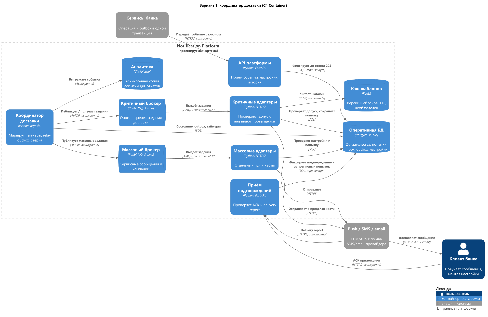
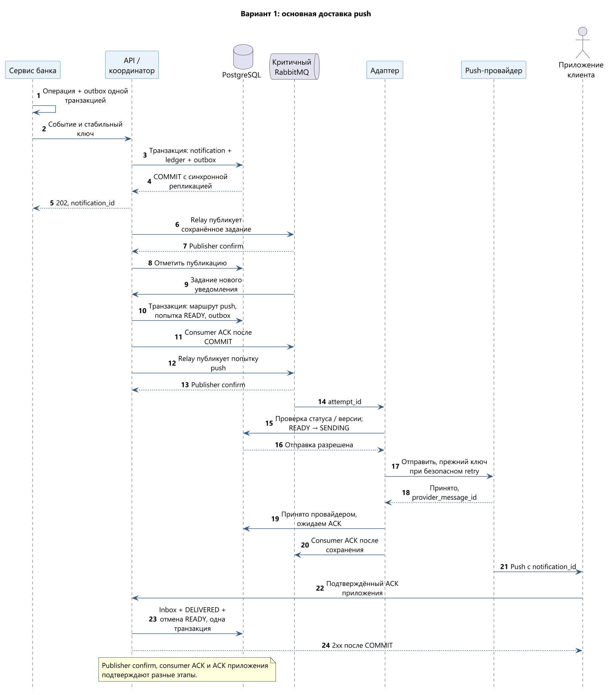
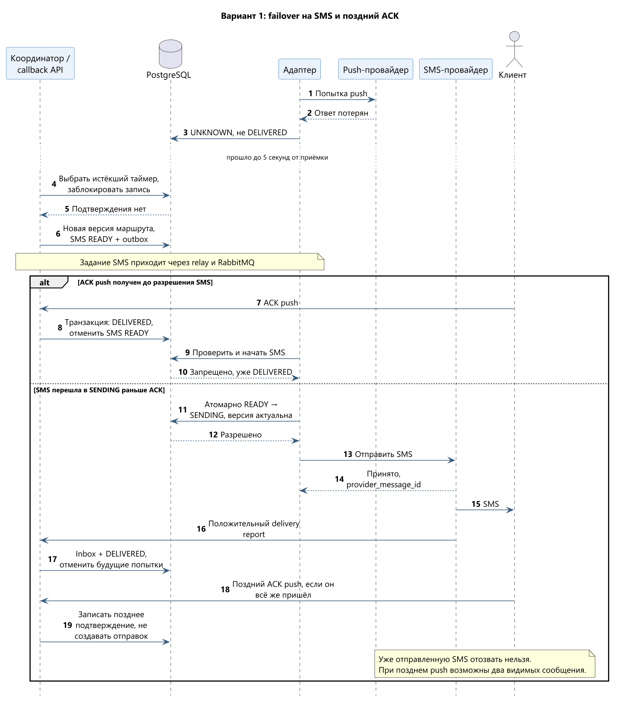
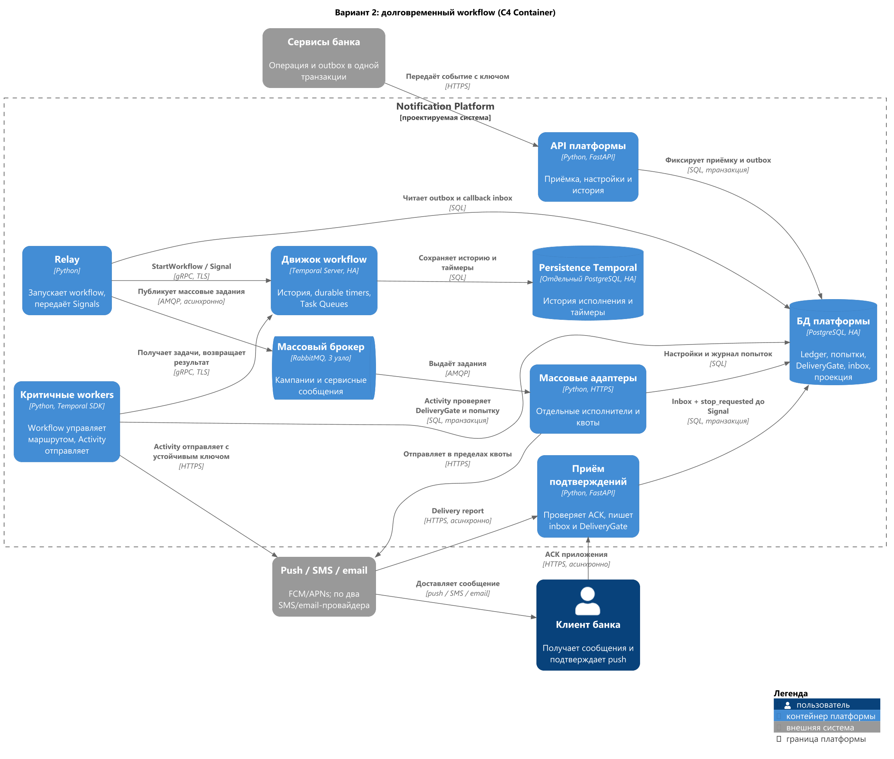
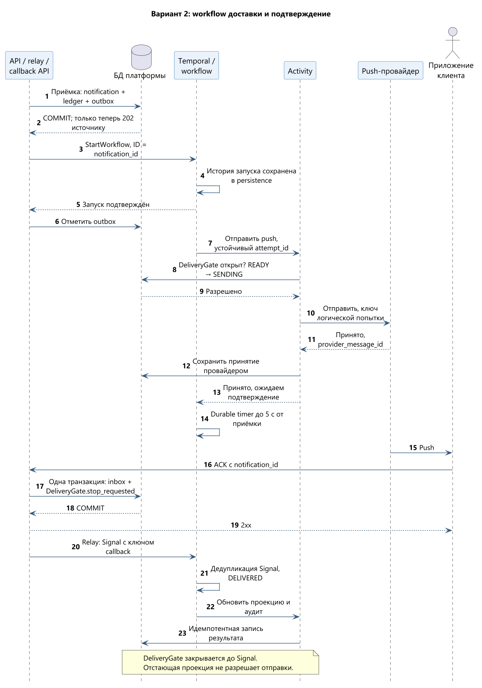
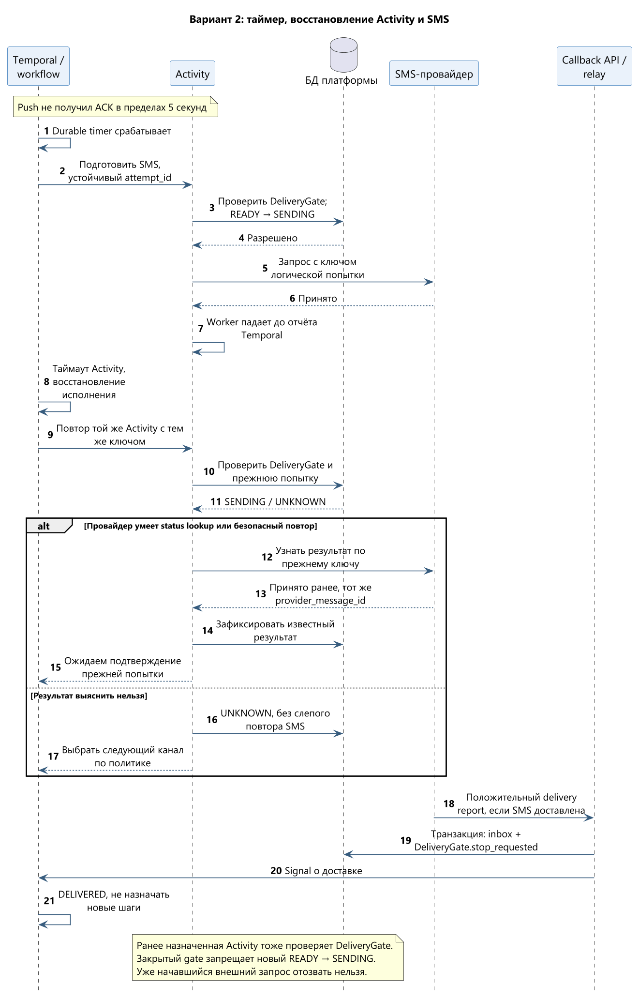

# RFC: Гарантированная доставка критичных уведомлений с автоматическим failover

| Метаданные | Значение |
|---|---|
| Статус | DESIGN |
| Автор | Артур Галимов |
| Ответственный | Артур Галимов |
| Бизнес-заказчик | Владелец Notification Platform |
| Ревьюеры | |
| Дата создания | 2026-11-15 |
| Дата обновления | 2026-11-17 |

## Оглавление

1. [Контекст](#контекст)
2. [Продуктовый анализ](#продуктовый-анализ)
3. [Пользовательские сценарии](#пользовательские-сценарии)
4. [Статистика](#статистика)
5. [Требования](#требования)
6. [Варианты решения](#варианты-решения)
7. [Сравнительный анализ](#сравнительный-анализ)
8. [Выводы](#выводы)
9. [Связанные задачи](#связанные-задачи)
10. [Приложения](#приложения)

## Контекст

Команды онлайн-банка отправляют уведомления самостоятельно, поэтому сообщения иногда задерживаются или дублируются. При недоставке бывает трудно установить причину. Централизованная Notification Platform должна обеспечить общие правила отправки и позволить проследить судьбу каждого сообщения.

Документ задаёт требования ко всей платформе, после чего подробно рассматривает доставку критичных уведомлений. Если основной канал не сработал, система должна автоматически перейти к резервному. При этом она учитывает настройки клиента и стоимость отправки. Банковскую операцию платформа не выполняет, а сообщает о её результате.

Для реализации предлагаются два варианта. В первом координатор управляет доставкой, опираясь на PostgreSQL и RabbitMQ. Во втором эту работу выполняет workflow в Temporal. Рекомендуется первый вариант при условии, что команда уже умеет сопровождать PostgreSQL и RabbitMQ.

### Что считается доставкой

Событие принимается только после долговременной записи. Затем обязательство сохраняется до подтверждения доставки или явного решения оператора. Даже если все каналы временно недоступны, уведомление остаётся нерешённым и видимым для поддержки.

| Канал | Достаточное подтверждение |
|---|---|
| Push | Приложение отправило ACK с идентификатором уведомления |
| SMS | Получен положительный delivery report с согласованной семантикой оператора |
| Email | Принимающий почтовый сервер подтвердил приём |

Тип подтверждения сохраняется в истории, поскольку каналы дают разные доказательства доставки. HTTP 200 от API провайдера означает, что задание принято, но ещё не подтверждает получение сообщения. Даже положительное подтверждение канала не доказывает, что человек прочитал уведомление.

Физическая доставка возможна, если у клиента есть действующий контакт и хотя бы один канал доступен либо впоследствии восстановится. При неверных контактах или длительной недоступности всех каналов система сохраняет обязательство и требует вмешательства.

## Продуктовый анализ

| Бизнес-цель | Как измеряем | Как платформа помогает |
|---|---|---|
| Увеличить retention на 15% | Относительный рост D30 retention, например с 30% до 34,5% | Полезное сообщение приходит вовремя и по удобному каналу |
| Снизить жалобы на 30% | Относительное снижение числа пользователей с жалобами на 10 000 активных пользователей за месяц | Клиент управляет необязательными сообщениями, а система ограничивает повторы |
| Обеспечить критичные уведомления | Доля подтверждённых доставок за 60 с и возраст нерешённых сообщений | При отказе основного канала включается резервный, а неудачная доставка остаётся под контролем |

Исходные показатели собираются за четыре недели. После пилота настройки и маркетинговые ограничения проверяются в эксперименте со случайным распределением пользователей. D30 сравнивается, когда для обеих когорт пройдёт 30 дней. Обязательная доставка сохраняется во всех группах, а ожидаемый рост retention проверяется как продуктовая гипотеза.

Сообщения о списаниях и переводах полностью отключить нельзя, поскольку они относятся к критичным. Клиент выбирает предпочтительный подтверждённый канал, а возможность резервной отправки объясняется в настройках. Маркетинг разрешается отключить целиком. Сервисными сообщениями можно управлять по категориям. Эти правила нужно согласовать с бизнесом и службой безопасности.

## Пользовательские сценарии

| Приоритет | Тип | Действующее лицо | Сценарий |
|---|---|---|---|
| MUST HAVE | Транзакционный | Клиент банка | После перевода получает сообщение по выбранному каналу, а при отказе используется резервный |
| MUST HAVE | Повторный запрос | Банковский сервис | Повторяет событие после потери ответа и получает прежний идентификатор уведомления |
| MUST HAVE | Настройки | Клиент банка | Отключает маркетинг, после чего ещё не начатые отправки отменяются |
| MUST HAVE | Кампания | Маркетолог | Запускает рассылку на миллион адресатов, сохраняя приоритет уведомлений об операциях |
| MUST HAVE | Инцидент | Поддержка | По банковской операции находит уведомление и выясняет причину его текущего состояния |
| MUST HAVE | Отказ каналов | Дежурный инженер | Получает сигнал о нерешённых сообщениях и возобновляет обработку после восстановления |
| SHOULD HAVE | Тихие часы | Клиент банка | Получает необязательные сообщения в разрешённое время, тогда как критичные отправляются сразу |

MUST HAVE обозначает обязательное поведение, а SHOULD HAVE обозначает желательное. Если подтверждённых контактов нет, система сохраняет уведомление и создаёт обращение для их исправления.

## Статистика

### Исходные данные и допущения

По условию MAU составляет 10 млн, а DAU составляет 3 млн пользователей. Одновременно активны до 300 000 человек. В день на пользователя приходятся 2 транзакционных уведомления, 3 сервисных и 5 маркетинговых. Кампания может охватить миллион адресатов.

В основном расчёте частоты относятся к DAU. Для оценки пика выбран коэффициент 10, а кампания должна отправляться за 10 минут. Размер задания принят равным 1 KiB. Среднее время вызова провайдера принято равным 200 мс. Эти величины являются допущениями, которые необходимо проверить измерениями.

| Категория | За день | В среднем за секунду | Пик с коэффициентом 10 |
|---|---:|---:|---:|
| Транзакционные | 6 000 000 | 69,4 | 694 |
| Сервисные | 9 000 000 | 104,2 | 1 042 |
| Маркетинговые | 15 000 000 | 173,6 | 1 736 |
| Всего | 30 000 000 | 347,2 | 3 472 |

Средняя нагрузка равна 3 000 000 × 10 / 86 400 = 347,2 уведомления/с. Дополнительная кампания создаёт 1 000 000 / 600 = 1 666,7 уведомления/с. Если она совпала с обычным пиком, суммарный поток составляет 3 472,2 + 1 666,7 = 5 138,9/с. С запасом выбирается мощность приёмки 6 000/с. Кампания здесь намеренно считается дополнительной к суточным средним.

Отдельно проверяется минутный всплеск, когда каждый из 300 000 одновременных пользователей совершает одну операцию. Тогда поступает 5 000 критичных событий/с, поэтому маркетинг временно приостанавливается. Этот сценарий не прибавляется к обычному пику.

Если заданные частоты относятся ко всем MAU ежедневно, объём вырастет до 100 млн уведомлений в сутки. Пик с кампанией составит около 13 241/с. Выбранной мощности 6 000/с в этом случае недостаточно, поэтому трактовку входных данных нужно подтвердить у заказчика.

### Исполнители и накопление очереди

Одно уведомление может потребовать несколько вызовов. При условном коэффициенте 1,2 поток 6 000/с создаёт 7 200 вызовов/с. Если средняя длительность равна 0,2 с, одновременно выполняются около 1 440 вызовов. При параллелизме 64 на экземпляр адаптера потребуется минимум 23 экземпляра. Размещение 36 экземпляров по трём зонам оставляет 24 после потери зоны. Квоты провайдеров должны допускать такой поток.

За 30 минут отказа при поступлении 1 000 критичных событий/с накопится 1,8 млн заданий. При размере 1 KiB они займут 1,84 GB, а с тремя репликами брокера потребуется 5,53 GB без служебных расходов. После восстановления скорость отправки 3 000/с при входном потоке 1 000/с позволит разбирать очередь на 2 000 заданий/с быстрее её пополнения. Накопление будет обработано за 900 с, то есть за 15 минут, если согласованные квоты позволяют такую отправку.

Полное состояние хранится в БД, а брокер получает короткие задания. Если свободного места становится мало, публикация замедляется. Платформа заранее ограничивает приёмку до заполнения диска, а непринятые события остаются в outbox банковского сервиса.

### Хранение

Бюджет одного уведомления составляет 3,5 KiB. Он складывается из основной записи размером 1 KiB, двух попыток по 0,5 KiB и шести аудиторских событий по 0,25 KiB. В эту среднюю оценку включены ключи дедупликации.

За сутки требуется 30 млн × 3,5 KiB = 107,52 GB. Семь дней истории всех категорий занимают 752,64 GB. Для хранения критичных сообщений ещё 23 дня потребуется 6 млн × 3,5 KiB × 23 = 494,592 GB. С коэффициентом 1,5 на индексы получается 1,87 TB на копию или 5,61 TB для основной БД и двух реплик. Дополнительно нужно место для резервных копий и WAL. Аналитика и persistence Temporal рассчитываются отдельно.

История разделяется по времени, чтобы завершённые старые записи можно было удалять порциями. Нерешённые обязательства и связанные с ними ключи сохраняются до разрешения. Если на событие приходится шесть изменений строк, поток 6 000/с создаст около 36 000 изменений строк/с. Достаточность конфигурации PostgreSQL проверяется на стенде, поскольку партиционирование само по себе не повышает её до нужной мощности.

### Стоимость каналов

Для иллюстрации примем внешнюю плату за push равной 0 условных единиц, за SMS равной 1, а за email равной 0,02. Это учебные значения, а реальные тарифы определяются договором.

Пусть все 6 млн критичных сообщений начинают с push и 90% подтверждаются вовремя. Тогда SMS требуется для 600 000 сообщений. Если 20% этих попыток не дали результата, email понадобится ещё для 120 000. Расход составит 600 000 × 1 + 120 000 × 0,02 = 602 400 единиц. Отправка всех сообщений по SMS стоила бы 6 млн единиц, поэтому в этом примере экономия близка к 90%.

Стоимость считается по оплачиваемым попыткам, поэтому SMS учтена для всех 600 000 отправок. Фактический расход вырастет при повторных вызовах или нескольких сегментах SMS. Если клиент предпочёл SMS первым каналом, это тоже изменит расчёт. Платформа выбирает самый дешёвый допустимый маршрут, который укладывается в срок, однако исчерпание маркетингового бюджета не останавливает критичные уведомления.

## Требования

### Функциональные требования

| № | Приоритет | Обозначение | Требование и цель |
|---|---|---|---|
| 1 | MUST HAVE | FR1 | Принимать сообщения всех команд банка, различать их категории и возвращать единый идентификатор для контроля |
| 2 | MUST HAVE | FR2 | Доставлять критичное сообщение хотя бы по одному допустимому каналу, а при отказе или превышении ожидания выбирать резервный |
| 3 | MUST HAVE | FR3 | Узнавать повтор банковского события и предотвращать новые отправки уже подтверждённого уведомления, чтобы снизить число дублей |
| 4 | MUST HAVE | FR4 | Позволять выбрать канал и отключить необязательные категории, сохраняя обязательную доставку критичных сообщений |
| 5 | MUST HAVE | FR5 | Перед отправкой проверять актуальные настройки и тихие часы, а маркетинг ограничивать двумя сообщениями в сутки по умолчанию |
| 6 | MUST HAVE | FR6 | Проводить кампании до миллиона адресатов так, чтобы сообщения об операциях сохраняли приоритет |
| 7 | MUST HAVE | FR7 | Показывать поддержке состояние доставки и причины его изменения, чтобы можно было разобрать обращение клиента |
| 8 | MUST HAVE | FR8 | При отказе всех каналов сохранять обязательство и сообщать дежурному, а после восстановления или исправления контакта возобновлять обработку |
| 9 | SHOULD HAVE | FR9 | Показывать маркетологу результат кампании и её стоимость, чтобы оценивать пользу рассылок |

### Нефункциональные требования

Численные значения задают проектные цели. Показатели рассчитываются по полному потоку соответствующей категории, а причины внешней недоставки показываются отдельно.

| № | Приоритет | Обозначение | Измеримая цель и проверка |
|---|---|---|---|
| 1 | MUST HAVE | NFR1 | Приёмка критичных событий доступна в 99,95% валидных запросов за месяц. В показатель входят ошибки инфраструктуры |
| 2 | MUST HAVE | NFR2 | От приёма до начала внешнего вызова p99 ≤ 2 с. Если резервный канал подтверждает доставку за ≤ 30 с, не менее 99,9% сообщений подтверждаются за 60 с. Проверяется трассировкой и синтетическими запросами |
| 3 | MUST HAVE | NFR3 | При потере узла или зоны RPO = 0 для принятых событий, а RTO ≤ 60 с. Проверяется аварийным отключением. Полная потеря региона выходит за эту модель отказа |
| 4 | MUST HAVE | NFR4 | Приёмка выдерживает 6 000 событий/с в течение 15 минут, включая до 1 000 критичных/с. Отдельно проверяются 5 000 критичных/с в течение минуты при остановленном маркетинге. При доступных каналах и достаточных квотах соблюдается NFR2 |
| 5 | MUST HAVE | NFR5 | После 100 000 повторов одного запроса или callback остаётся одна логическая запись. Конкурентное задание не начинает новую попытку после DELIVERED. Неоднозначный внешний результат проверяется отдельным сценарием |
| 6 | MUST HAVE | NFR6 | При кампании на миллион адресатов p99 начала критичной отправки остаётся ≤ 2 с, что проверяется смешанной нагрузкой |
| 7 | MUST HAVE | NFR7 | Если изменение настроек зафиксировано до начала маркетинговой отправки, применяются новые настройки. Граница проверяется тестом гонки, поскольку ранее начатое сообщение ещё может прийти |
| 8 | MUST HAVE | NFR8 | По notification_id и attempt_id доступны канал, время и результат попытки. Задержка метрик ≤ 30 с. Если критичное сообщение не продвигается 60 с, сигнал возникает в течение следующей минуты |
| 9 | MUST HAVE | NFR9 | Все сетевые соединения платформы защищены TLS. История доступна по ролям, а просмотры аудируются. Обычные логи и метки метрик не содержат текстов сообщений или контактов. Проверяется настройками и поиском утечек |
| 10 | SHOULD HAVE | NFR10 | Завершённая история хранится 7 дней, а критичная хранится 30 дней. Просроченные записи удаляются в течение 24 ч. Нерешённое обязательство сохраняется до разрешения |
| 11 | SHOULD HAVE | NFR11 | После отключения Redis приёмка и отправка продолжаются при расчётной нагрузке, поскольку шаблоны читаются из БД |

Доступность API и успешность доставки измеряются отдельно. Если сообщение принято, но не подтверждено за 60 секунд, оно ухудшает показатель доставки даже при работающем API. Сохранённое обязательство не считается успешной доставкой.

### ASR и архитектурные последствия

Приоритет P1 назначен сохранности и корректности, а P2 назначен скорости и эффективности. Снижение задержки не должно приводить к потере принятого сообщения.

| ASR | Приоритет | Связанные требования | Почему влияет на архитектуру и последствия |
|---|---|---|---|
| ASR1. Сохранность и восстановление | P1 | FR1, FR2, FR8; NFR1, NFR3 | Состояние нужно записывать до ответа источнику, а задания восстанавливать после сбоя. Поэтому требуются outbox и репликация |
| ASR2. Задержка при массовой нагрузке | P2 | FR2, FR6; NFR2, NFR4, NFR6 | Обработка должна быть асинхронной, причём критичным заданиям нужны отдельные ресурсы, чтобы кампания их не блокировала |
| ASR3. Безопасность повторов | P1 | FR2, FR3; NFR5 | При повторе нужно узнавать прежнюю попытку и согласованно менять её состояние. Поэтому необходимы устойчивые ключи и атомарный допуск отправки |
| ASR4. Настройки и стоимость | P2 | FR4, FR5, FR9; NFR7 | Маршрут выбирается общей политикой, которая проверяет актуальные разрешения и учитывает цену каждой попытки |
| ASR5. Наблюдаемость и защита | P1 | FR7, FR8; NFR8, NFR9, NFR10 | Доставку нужно проследить по журналу, а доступ к нему ограничить. Поэтому подтверждения проверяются и связываются с конкретными попытками |

### Архитектурные вопросы

| Вопрос | Связанные требования | Почему важен |
|---|---|---|
| Когда отвечать источнику, что событие принято? | ASR1, NFR3 | Если ответить до записи, сбой может безвозвратно потерять уведомление |
| Как восстановить текущий канал и таймер? | ASR1, ASR3 | Если состояние осталось только в памяти, после перезапуска его придётся угадывать |
| Что делать, если провайдер не ответил? | ASR3, FR2, FR3 | Запрос мог исполниться, поэтому безусловный повтор способен создать вторую SMS |
| Как отделить кампанию от критичной доставки? | ASR2, NFR6 | Общая очередь и исчерпанные соединения могут задержать сообщение о переводе |
| Как обработать позднее подтверждение push? | ASR3, NFR2 | Оно может совпасть с началом SMS, поэтому нужно определить границу отмены и допустимый риск дубля |
| Когда применять новые настройки? | ASR4, NFR7 | Устаревшее разрешение из кэша может привести к отправке после отписки |

### Решения, которые не подходят

| Решение | Нарушаемый ASR | Причина |
|---|---|---|
| Отправка внутри запроса перевода без сохранённого задания | ASR1, ASR2 | Провайдер задерживает банковскую операцию, а падение после её фиксации теряет уведомление |
| Единственная очередь обязательств в памяти или кэше | ASR1 | После сброса памяти обязательства теряются, а отложенная запись оставляет окно потери |
| Одна FIFO-очередь для маркетинга и транзакций | ASR2 | Критичное сообщение может оказаться за миллионом рекламных заданий |
| Признание HTTP 200 провайдера окончательной доставкой | ASR1, ASR3, ASR5 | Сообщение ещё может не дойти, но система уже перестанет искать резервный маршрут |

### Неопределённости и проверки

| Что неизвестно | Как проверить и использовать результат |
|---|---|
| Частоты относятся к DAU или MAU, а также каков минутный пик? | Уточнить у заказчика и собрать профиль за четыре недели. При базе MAU пересчитать мощность под пик около 13,3 тыс./с |
| Какие подтверждения и гарантии повторов дают провайдеры? | В песочнице потерять ответ и проверить поиск по прежнему ключу. На Android/iOS измерить ACK в фоне и офлайн. По результатам выбрать поставщиков и сроки ожидания |
| Есть ли у команды опыт Temporal? | Прототипом проверить восстановление workflow после падения worker. Если сопровождение освоено, пересмотреть выбор варианта |
| Какие правила хранения и обязательности допустимы? | Согласовать их с бизнесом и ИБ, после чего подтвердить сроки 7/30 дней и размещение данных |
| Выдержит ли БД смешанный поток? | Воспроизвести 36 тыс. изменений строк/с вместе с callback и очисткой истории. Если оптимизации индексов недостаточно, рассмотреть шардинг по пользователю |

## Варианты решения

### Общие правила доставки

Ключ producer_id + event_id + recipient_id + notification_type определяет логическое уведомление. Поэтому сообщение по тому же переводу другому получателю не будет ошибочно подавлено. Ключ сохраняется минимум 30 дней, хотя договор с источником ограничивает обычные повторы семью днями. Более поздний повтор требует сверки. Если прежний ключ пришёл с другим содержимым, возвращается конфликт.

Попытка имеет постоянный attempt_id, а ключ провайдера строится как notification_id + channel + provider + route_step. Безопасный технический повтор использует прежний ключ. Следующий шаг маршрута получает новый. Callback связывается с attempt_id и provider_message_id, а повтор события провайдера определяется по provider + event_id.

| Объект | Состояния |
|---|---|
| Уведомление | ACCEPTED → IN_PROGRESS → DELIVERED; при проблемах RETRY_WAIT или NEEDS_ATTENTION |
| Попытка | READY → SENDING → ACCEPTED_BY_PROVIDER → CONFIRMED; возможны UNKNOWN, FAILED и CANCELLED |

DELIVERED устанавливается только по подтверждению, определённому в контексте. NEEDS_ATTENTION сохраняет обязательство, поэтому поздний положительный результат ещё может закрыть его.

По умолчанию сначала используется push, затем SMS и после неё email. Предпочтение клиента меняет порядок допустимых каналов. Неподтверждённый контакт пропускается, а при достоверном отказе можно сменить провайдера внутри канала. Версия выбранной политики сохраняется вместе с маршрутом, но перед внешним вызовом повторно проверяются текущие разрешения и контакты.

Подтверждение push ожидается до пяти секунд от приёмки. На SMS выделяется до 20 секунд после её начала, а email использует остаток целевого окна 60 секунд. Достоверный отказ позволяет переключиться раньше. Вызов провайдера ограничен одной секундой. Если повтор безопасен и укладывается в бюджет, допускаются три попытки с паузами 100 и 200 мс, к которым добавляется случайный разброс. Ошибка контакта или шаблона не повторяется. Временная ошибка и HTTP 429 обрабатываются с учётом Retry-After и оставшегося срока.

Если ответ потерян, попытка становится UNKNOWN. Результат выясняется по прежнему ключу либо безопасным повтором, если провайдер поддерживает идемпотентность. Когда это невозможно, та же неопределённая попытка повторно не отправляется. Для срочной доставки разрешается следующий канал, однако причина риска дубля записывается в аудит. Если весь маршрут исчерпан, обязательство остаётся открытым. Новая платная попытка требует разрешения политики или оператора, поэтому бесконечного автоматического клонирования отправок нет.

### Позднее подтверждение и гонка каналов

Перед внешним вызовом исполнитель атомарно проверяет, что уведомление ещё не DELIVERED и версия маршрута актуальна. Затем он переводит READY в SENDING. Координатор и обработчик подтверждений сериализуют изменения одной записи.

Если ACK push зафиксирован первым, SMS в READY отменяется. Когда SMS уже перешла в SENDING, внешний запрос мог уйти, поэтому поздний ACK не позволяет гарантированно отозвать сообщение у оператора. Система запрещает новые разрешённые попытки после DELIVERED, но не обещает отменить ранее начатый запрос.

После сбоя зависшая SENDING переходит в UNKNOWN. Lease ограничивает владение задачей по времени, а fencing version запрещает старому исполнителю менять актуальное состояние в БД. Остановить его внешний эффект может только идемпотентный контракт провайдера. Поэтому абсолютное отсутствие видимых дублей между независимыми каналами нельзя совместить с конечным сроком доставки при потерянных подтверждениях.

Риск уменьшается благодаря короткому сроку жизни push и отмене ещё не начатых попыток. Приложение дополнительно подавляет повторное отображение по notification_id. При этом TTL не отзывает push, который уже передан получателю. Для критичных сообщений выбран приоритет доставки, а межканальные дубли учитываются отдельной метрикой.

### Вариант 1: PostgreSQL, RabbitMQ и собственный координатор

#### Архитектура

API реализуется на Python с FastAPI, а фоновые процессы используют asyncio. PostgreSQL хранит состояние доставки. RabbitMQ с quorum queues распределяет задания по AMQP. Redis используется только как необязательный кэш шаблонов. Push отправляется через FCM/APNs, а для SMS и email предусмотрены HTTPS-адаптеры к двум провайдерам каждого типа. Поставщики выбираются после проверки квот и контракта подтверждений.

API одной транзакцией записывает notification, ключ дедупликации и outbox. Только после COMMIT источник получает 202 и notification_id. Сам банковский сервис также записывает исходящее событие в одной транзакции с операцией, чтобы падение не оставило платформу без задания.

В координатор входят обработчик состояния и планировщик. Relay публикует outbox и помечает запись отправленной после publisher confirm. Если процесс упал между подтверждением и отметкой, публикация повторится, поэтому получатель проверяет ключ. Consumer ACK выдаётся после транзакции, которая сохранила состояние и следующие задания. Оба подтверждения брокера относятся к передаче задания, тогда как доставку клиенту подтверждает канал.

Координаторы выбирают истёкшие next_action_at через SELECT FOR UPDATE SKIP LOCKED. В транзакции они сохраняют lease и fencing version, после чего освобождают блокировку. Вызов провайдера выполняется снаружи транзакции. Периодическая сверка возвращает в обработку незавершённый outbox и задачи с истёкшим владением, даже если задание пробуждения потерялось.

Критичные и массовые сообщения обслуживаются разными кластерами RabbitMQ. Каждый кластер состоит из трёх узлов в трёх зонах, поэтому quorum queue сохраняет работоспособность при потере одного узла и наличии большинства. У критичной доставки отдельные адаптеры и зарезервированные квоты провайдеров.

Чтобы маркетинг не перегрузил общую БД, кампания создаёт задания ограниченными порциями и использует ограниченный пул соединений. Если возраст критичной очереди превысил 500 мс, массовая публикация приостанавливается. API и адаптеры принадлежат одному домену доставки, поэтому используют общую модель данных. Остальные банковские сервисы обращаются к ним через API.

У PostgreSQL есть основной узел и две реплики. Подтверждённая запись синхронно сохраняется хотя бы на одной реплике. Patroni с кворумом DCS из трёх узлов выбирает доступную реплику со всеми подтверждёнными данными, а fencing исключает старый primary. Автоматическое ослабление фиксации до асинхронной не допускается, иначе обещанный RPO = 0 потеряет основание.

#### Данные и транзакции

| Сущность | Назначение и ограничение |
|---|---|
| Notification | Хранит маршрут и состояние. Бизнес-ключ допускает одно логическое уведомление |
| DeliveryAttempt | Хранит результат шага и ключ провайдера. Один шаг маршрута создаётся один раз |
| Outbox | Сохраняет событие для публикации в транзакции с изменением состояния |
| CallbackInbox | Сохраняет проверенное подтверждение до ответа 2xx и узнаёт его повтор |
| Preferences | Хранит актуальную версию настроек и подтверждённые контакты |
| AuditEvent | Позволяет установить причину и время перехода по идентификаторам доставки |

Обновление настройки и допуск отправки сериализуются по записи получателя. Если Preferences изменились первыми, новая маркетинговая попытка отменяется. Если раньше зафиксирован SENDING, сообщение считается начатым и может прийти после отписки. Блокировка не удерживается на время сетевого вызова.

Redis хранит шаблон по ключу его версии с TTL 5 минут. При отсутствии ключа или отказе кэша шаблон читается из PostgreSQL. Ключи дедупликации и разрешение отправки проверяются в БД, чтобы устаревший кэш не влиял на корректность.

Для тяжёлых отчётов события асинхронно выгружаются в ClickHouse. Допускается задержка аналитики до пяти минут, а состояние конкретной доставки читается из оперативной БД.

#### Выполнение ASR

| ASR | Как выполняется в варианте 1 |
|---|---|
| ASR1 | Outbox сохраняется до ответа 202, а репликация и сверка обеспечивают восстановление принятых задач |
| ASR2 | Раздельные брокеры и пулы адаптеров защищают критичный поток, а массовая публикация ограничивается |
| ASR3 | Устойчивые ключи узнают повтор, а атомарный переход в SENDING и обработка UNKNOWN согласуют попытки |
| ASR4 | Политика выбирает допустимый канал и проверяет актуальные настройки перед платной отправкой |
| ASR5 | Inbox связывает подтверждение с попыткой, а аудит и ограниченный доступ позволяют безопасно разбирать инциденты |

#### Этапы реализации

Оценка предполагает двух backend-разработчиков и SRE на половину занятости. Согласование договоров учитывается отдельно.

| Этап | Работа | Срок | Ресурсы | Основной риск |
|---|---|---|---|---|
| 1 | Согласовать контракт и реализовать outbox источника | 1 неделя | Backend и аналитик | Неверный бизнес-ключ |
| 2 | Реализовать координатор с адаптерами и подтверждениями | 2 недели | 2 backend | Гонки и UNKNOWN |
| 3 | Настроить отказоустойчивость и провести испытания | 2 недели | Backend и SRE | Квоты и мощность БД |
| 4 | Постепенно включить доставку от 1% до 100% | 1 неделя | Команда и поддержка | Реальные задержки ACK |

#### Преимущества

Предметное состояние доступно обычными запросами к PostgreSQL, поэтому причину перехода легко проследить. Короткий маршрут из трёх каналов позволяет обойтись без отдельного движка workflow. Массовые отправители масштабируются независимо от критичных.

#### Недостатки

Команда самостоятельно отвечает за корректность таймеров и восстановления. С ростом числа ветвлений координатор станет сложнее, а частые переходы будут нагружать БД. Изоляция брокеров также увеличивает расход инфраструктуры.

### Вариант 2: Temporal для критичной доставки

#### Архитектура

Входной API остаётся на FastAPI. Temporal Server с Python SDK управляет критичными процессами, а массовые кампании продолжают работать через RabbitMQ. PostgreSQL платформы хранит приёмку и аудит. Для persistence Temporal используется отдельная отказоустойчивая PostgreSQL.

После приёмки relay запускает workflow с постоянным Workflow ID = notification_id. Политика идентификаторов запрещает повторный запуск открытого или завершённого процесса в пределах срока дедупликации. Входной ledger дополнительно сохраняет запрет после удаления закрытой истории. Если relay упал, задание остаётся в outbox.

Один workflow управляет уведомлением и вызывает Activity отправки, после чего ждёт Signal либо durable timer. Благодаря истории процесс восстанавливается после падения worker. Сетевые вызовы выполняются в Activities, а версия маршрута сохраняется в истории.

Маршрутом владеет workflow, а БД хранит фактические попытки. Проекция поддержки может отставать до пяти секунд и не разрешает отправки. Повторы Signal узнаются по ключу callback.

Атомарный запрет новых отправок хранится отдельно в DeliveryGate. Когда callback подтверждает доставку, одна транзакция записывает inbox и устанавливает stop_requested до передачи Signal. Любая Activity, включая ранее назначенную или повторную, блокирует ту же запись перед переходом READY → SENDING. Если gate закрыт, она возвращает результат о подтверждённой доставке без вызова провайдера. Если SENDING зафиксирован раньше, сохраняется уже описанный риск начавшегося внешнего запроса.

Callback API отвечает 2xx после COMMIT, а relay передаёт Signal до подтверждения Temporal. Событие, которое пришло до запуска workflow, остаётся в inbox и передаётся позже. Если workflow уже завершён, сверка записывает поздний результат в аудит и обновляет проекцию без нового уведомления.

Activity может повториться после падения между внешним эффектом и отчётом Temporal. Поэтому она использует прежний attempt_id и проверяет состояние адаптера. UNKNOWN обрабатывается по общим правилам, поскольку сам движок не делает отправку SMS идемпотентной.

Temporal размещается в трёх зонах с синхронной защитой persistence, а критичные workers отделяются от массовых. При Continue-As-New переносятся идентификаторы и ключи активных попыток. Ledger удерживает нерешённое обязательство после очистки истории.

#### Выполнение ASR

| ASR | Как выполняется в варианте 2 |
|---|---|
| ASR1 | Outbox запускает устойчивый workflow, а история сохраняет таймеры. Ledger удерживает нерешённое обязательство |
| ASR2 | Критичные Task Queues и workers отделены от массового RabbitMQ и масштабируются независимо |
| ASR3 | Workflow согласует маршрут, DeliveryGate запрещает новые вызовы, а ключи Activity и провайдера защищают повтор |
| ASR4 | Activity проверяет текущие настройки, а зафиксированная политика определяет порядок каналов и стоимость попыток |
| ASR5 | История workflow дополняет предметный аудит, причём доступ к Temporal UI и журналам ограничивается ролями |

#### Этапы реализации

| Этап | Работа | Срок | Ресурсы | Основной риск |
|---|---|---|---|---|
| 1 | Создать outbox и прототип workflow | 1 неделя | 2 backend | Повторный запуск |
| 2 | Подключить Activities и подтверждения через inbox | 2 недели | 2 backend | Повтор внешнего эффекта |
| 3 | Развернуть кластер и проверить восстановление | 3 недели | Backend и SRE | Сопровождение Temporal |
| 4 | Постепенно включить новый процесс | 1 неделя | Команда и поддержка | Обновление workflows |

#### Преимущества

Движок сохраняет ожидание и восстанавливает исполнение, поэтому собственный планировщик не требуется. Если маршрут усложнится, новые ветвления удобнее выразить в workflow. История помогает выяснить, на каком шаге процесс остановился.

#### Недостатки

Команде придётся сопровождать ещё одну распределённую систему и соблюдать правила обновления workflow-кода. При этом адаптеры всё равно должны безопасно обрабатывать повтор, а outbox и предметный аудит остаются необходимыми. Дополнительное хранилище истории увеличивает требования к эксплуатации.

## Сравнительный анализ

### Ресурсные требования

Сроки и состав стенда являются предварительной оценкой, которую уточняют после прототипа.

| Критерий | Вариант 1 | Вариант 2 |
|---|---|---|
| Время реализации | Около 6 недель | Около 7 недель, если Temporal нужно освоить |
| Команда | 2 backend и SRE на 0,5 ставки | Такой же состав, но необходимо обучение Temporal |
| БД | Основной PostgreSQL и две реплики | PostgreSQL платформы и отдельный HA PostgreSQL для Temporal |
| Обработка заданий | Два кластера RabbitMQ по три узла, отдельный координатор | Temporal для критичных процессов и три узла RabbitMQ для массовых |
| Отправители | В расчётном примере до 36 экземпляров адаптеров | Сопоставимый параллелизм Activities, но workflow workers оцениваются отдельно |
| Организационный риск | Команда может недооценить сложность собственного автомата | При отсутствии экспертизы усложнятся сопровождение и обновления |

Redis и аналитическое хранилище используются в обоих вариантах по одним и тем же причинам. Система наблюдаемости также общая по назначению, а Temporal дополнительно требует контроля собственного кластера.

### Соответствие требованиям

Таблица показывает предусмотренные механизмы. Численные SLO подтверждаются испытаниями реализации.

| Требования | Вариант 1 | Вариант 2 |
|---|---|---|
| FR1, FR2, FR8 | Сохранённый автомат доставки восстанавливается из БД | Workflow восстанавливается из истории |
| FR3, NFR5 | Уникальные шаги и атомарный переход согласуют повтор | Workflow ID, DeliveryGate и ключи Activity согласуют повтор |
| FR4, FR5, NFR7 | Настройки проверяются перед SENDING | Activity проверяет настройки перед SENDING |
| FR6, NFR4, NFR6 | Массовый брокер и адаптеры изолированы | Массовый контур отделён от критичных Task Queues |
| FR7, FR9, NFR8 | Предметный аудит и отдельная аналитика | Аудит дополняется историей workflow |
| NFR1, NFR2, NFR3 | Проверяются задержки координатора и failover БД | Дополнительно проверяются Task Queues и persistence Temporal |
| NFR9, NFR10, NFR11 | Действуют общие правила защиты, хранения и работы без кэша | Те же правила распространяются и на Temporal |

### Ключевые компромиссы

Дешёвый push уменьшает расход SMS, но требует подождать подтверждение перед резервной отправкой. Синхронная репликация защищает принятые записи, хотя фиксация становится медленнее и может остановиться без доступной синхронной реплики. Изоляция маркетинга сохраняет критичную мощность, однако требует дополнительных ресурсов. Отчёты не нагружают оперативную БД, но обновляются с задержкой.

## Выводы

Выбран вариант 1, поскольку короткий маршрут из трёх каналов не требует отдельного движка workflow. При принятом допущении об опыте команды с PostgreSQL и RabbitMQ предметное состояние будет проще сопровождать в одной модели. Если в банке уже есть освоенная платформа Temporal или маршруты заметно усложнятся, вариант 2 станет предпочтительнее.

Принимаются ограничения, описанные в контексте и сценарии гонки каналов. Дополнительно нужно подтвердить квоты провайдеров и нагрузку на БД. Потеря региона выходит за заявленный RPO, а переход от базы DAU к ежедневной отправке всем MAU потребует пересчёта мощности.

## Связанные задачи

| Задача | Критерий завершения |
|---|---|
| T1. Уточнить нагрузку и политику | Подтверждены база DAU/MAU и правила обязательности, а для события согласован ключ |
| T2. Выбрать провайдеров | В песочнице проверены повтор и подтверждение, после чего согласованы квоты и тарифы |
| T3. Реализовать доставку | Основной и резервный сценарии проходят от outbox источника до подтверждения |
| T4. Провести испытания | Повторы не создают новое уведомление, а смешанная нагрузка и отказ зоны проверяют NFR2, NFR3, NFR4 и NFR6 |
| T5. Подготовить запуск | Дежурный умеет разбирать NEEDS_ATTENTION, затем проводится пилот и измеряется продуктовый результат |

При миграции событие закрепляется за одним контуром. Второй проверяется без внешних отправок, чтобы сравнение не создавало дублей. При откате уже принятые и неопределённые попытки сверяются по прежним идентификаторам и не запускаются заново старым отправителем.

### Проверка ключевых сбоев

| Сценарий | Ожидаемый результат |
|---|---|
| Источник упал после фиксации перевода или потерял ответ API | Outbox повторяет событие, а платформа возвращает прежний notification_id |
| Relay упал после publisher confirm | Повторная публикация не создаёт второй шаг маршрута |
| Worker упал после внешнего вызова | Попытка становится UNKNOWN, а результат проверяется по прежнему ключу |
| ACK совпал с началом SMS или callback пришёл повторно | Переход сериализуется, READY отменяется, а поздний результат не создаёт новой отправки |
| Все каналы отказали | Обязательство остаётся открытым, возникает сигнал, а обработка возобновляется контролируемо |
| Кампания совпала с высокой нагрузкой, после чего потеряна зона | Проверяются p99 ≤ 2 с под смешанной нагрузкой и RTO ≤ 60 с при аварии. Принятые записи не теряются, а аварийные задержки входят в SLI |
| Настройка изменилась при выключенном Redis | Отправка следует границе SENDING и актуальной записи в БД |

### Наблюдаемость

OpenTelemetry связывает приёмку с конкретной попыткой и её подтверждением. В Prometheus и Grafana отображаются задержка начала отправки и доля доставок за 60 с. Для дежурного особенно важны возраст старейшего нерешённого сообщения и скорость роста очереди. Отдельно отслеживаются UNKNOWN и переключения каналов, чтобы объяснять рост расходов и дублей. Идентификаторы находятся в трассах и аудите, но не используются как метки метрик с высокой кардинальностью.

Сигнал возникает, если сообщение не продвигается 60 секунд, либо подтверждения перестали поступать при продолжающейся отправке. Инструкция дежурного помогает проверить канал и квоту, а затем решить, требуется ли исправление контакта или новая попытка. Поддержка видит маскированные контакты, а полный доступ выделен отдельной роли. Callback проверяется подписью или mTLS, поэтому неподтверждённый отправитель не может закрыть чужое уведомление. Повторное воспроизведение callback отсеивается по сохранённому ключу.

## Приложения

### Глоссарий

| Термин | Значение |
|---|---|
| RFC | Предложение, в котором до реализации сравниваются архитектурные варианты |
| ASR | Требование, которое существенно влияет на устройство системы |
| Failover | Переход к резервному каналу или провайдеру |
| Outbox | Исходящее событие, записанное в транзакции с предметным изменением |
| Идемпотентность | Повтор одного действия сохраняет прежний результат |
| At-least-once | Доставка задания допускает повтор, который учитывает получатель |
| UNKNOWN | Вызов мог исполниться, но надёжный результат ещё не известен |
| Lease и fencing | Временное владение задачей и защита от изменения состояния устаревшим владельцем |
| SLI / SLO | Измеряемый показатель и его целевое значение |
| RPO / RTO | Допустимая потеря данных по времени и срок восстановления |
| C4 Container | Представление приложений и хранилищ со связями между ними |

Исходники шести диаграмм находятся в каталоге diagrams в формате PlantUML.
